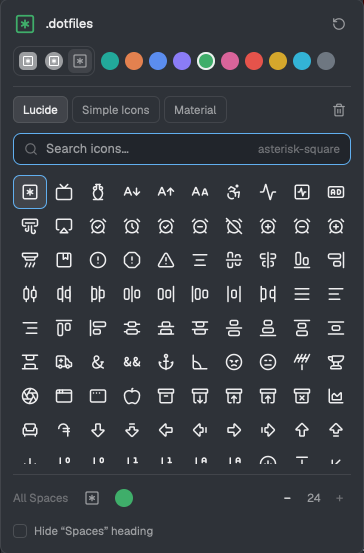

# herdr-mods

Space icons for the [Herdr](https://herdr.dev) app, plus a few small mods.

## Packages

<table>
<tr><th>Package</th><th>What it does</th><th>Key</th></tr>
<tr><td><a href="space-icons/"><code>space-icons</code></a></td><td>Icons for spaces, picked from the sidebar: Lucide, Simple Icons, Material Symbols.</td><td>Click the space icon</td></tr>
<tr><td colspan="3">

```
Read ~/.config/herdr-app/AGENTS.md, then add this layout:
https://github.com/scarrillo/herdr-mods/tree/main/space-icons
```

</td></tr>
<tr><td><a href="shell-popup/"><code>shell-popup</code></a></td><td>A scratch shell in a popup, in the focused terminal's folder.</td><td><code>cmd-shift-a</code></td></tr>
<tr><td colspan="3">

```
Read ~/.config/herdr-app/AGENTS.md, then add this mod:
https://github.com/scarrillo/herdr-mods/tree/main/shell-popup
```

</td></tr>
<tr><td><a href="finder-open/"><code>finder-open</code></a></td><td>Opens the focused terminal's folder in Finder. macOS only.</td><td><code>cmd-o</code></td></tr>
<tr><td colspan="3">

```
Read ~/.config/herdr-app/AGENTS.md, then add this mod:
https://github.com/scarrillo/herdr-mods/tree/main/finder-open
```

</td></tr>
<tr><td><a href="lazygit-popup/"><code>lazygit-popup</code></a></td><td>lazygit in a popup, in the focused terminal's folder. Needs <code>lazygit</code>.</td><td><code>cmd-g</code></td></tr>
<tr><td colspan="3">

```
Read ~/.config/herdr-app/AGENTS.md, then add this mod:
https://github.com/scarrillo/herdr-mods/tree/main/lazygit-popup
```

</td></tr>
</table>

To install a package, give your agent the prompt under it.

For example, the [`space-icons`](space-icons/) picker:



## Requirements

Herdr 0.1.16 or later. Tested on macOS.

Each package's README has the by-hand install, and how to update or remove it.

## License

[MIT](LICENSE), except:

- `space-icons/mods/spaces-icons/` and `space-icons/layouts/main-icons.json` are modified copies
  of [Herdr](https://github.com/herdrdev/herdr-app)'s `spaces` mod and `main` layout (0.1.16),
  under [Apache 2.0](space-icons/mods/spaces-icons/LICENSE-Herdr.txt). The changes are marked
  `space-icons` in the mod; the layout's one change is the sidebar mod's name.
- Icons are downloaded from the picker under their own terms: Lucide
  ([ISC](space-icons/mods/space-icon/LICENSE-Lucide.txt)), Material Symbols (Apache 2.0),
  Simple Icons (CC0; each logo belongs to its brand).
