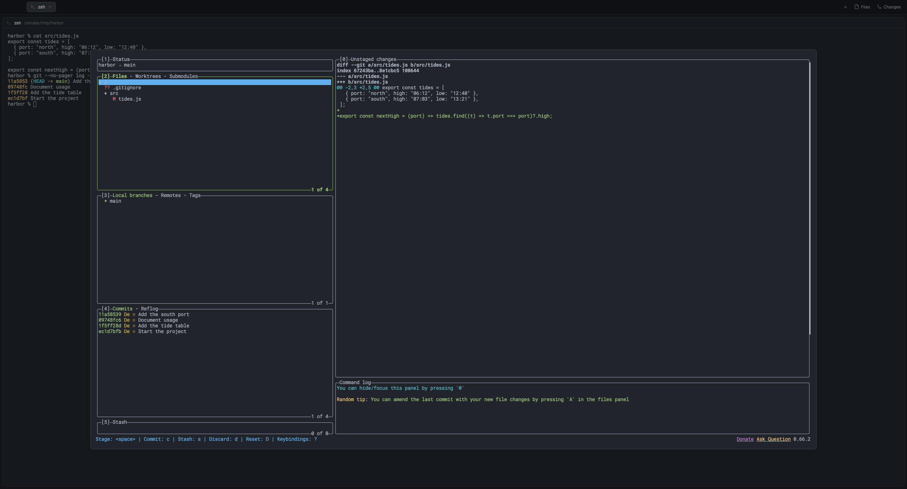

# lazygit-popup

lazygit in a popup over the window, in the focused terminal's folder. Works for spaces on other
machines too. The popup closes when lazygit exits.



- Key: `cmd-g`
- Needs: `lazygit` on the space's machine.
- To change the size or the program, edit `SIZE` and `ARGV` in `mods/lazygit-popup/main.js`.

## Install

Give your agent this:

```
Read ~/.config/herdr-app/AGENTS.md, then add this mod:
https://github.com/scarrillo/herdr-mods/tree/main/lazygit-popup
```

Or by hand, from a clone of this repo:

```sh
cp -R lazygit-popup/mods/lazygit-popup ~/.config/herdr-app/mods/
```

Then add the key from this folder's `keys.json` to `~/.config/herdr-app/keys.json`. The mod loads
at once; no restart. Needs Herdr 0.1.16 or later.

## Update and remove

- Update: install it again over the old copy.
- Remove: delete `~/.config/herdr-app/mods/lazygit-popup/` and its key from `keys.json`.
