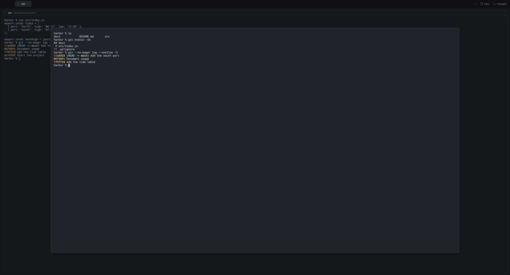

# Shell popup

Press a key and a scratch shell opens over the window, in the folder of the terminal you were in.
Exit the shell and the popup is gone.

## What you see

A dialog over the window, 80% of its width and height, dimming what is behind it. It holds one
terminal running the machine's login shell, with Herdr's own dialog frame. Nothing else is drawn.

## How it behaves

- `cmd-shift-a` opens it. It starts in the focused terminal's live folder, on that space's
  machine.
- It is modal: a click beside it doesn't close it, and keys go to the shell.
- It closes when the shell exits; its terminal is removed with it.
- If the shell can't start, an error toast says why and nothing opens.
- It shows no agent status.

## Built from

- `mods/shell-popup/mod.json`:
  `{ "place": "none", "title": "Shell popup", "overlay": { "kind": "popup", "width": 1, "height": 1, "frame": "none" } }`.
- `mods/shell-popup/main.js`: a `View` that draws an empty `div()`. In `init`, when
  `props().overlay` is set, it spawns a task that:
  1. reads `focused()` for `cwd` and `space`, and that space's `machine` from `spaces()`;
  2. runs `hc(["run", "--bg", "--json", "--rm", "--no-parent", "--cwd", cwd, "--on", machine])`
     (`--cwd` and `--on` only when known; no program, so hc starts the login shell);
  3. closes its own 1 × 1 overlay with `closeOverlay(props().overlay)`;
  4. opens `openOverlay({ kind: "dialog", modal: true, width: 0.8, height: 0.8, layout: { type: "block", content: { terminal: address } } })`
     with the `address` from hc's JSON.

  A failure closes the 1 × 1 overlay too.
- `keys.json`: `"cmd-shift-a": "mod.open:shell-popup"` in `global`.
- Runs `hc run`. No network.
- Constants at the top of `main.js`: `ARGV = []`, `SIZE = 0.8`.

## Watch out

- `herdr-app check` runs `init` without an overlay: return early when `props().overlay` is
  missing, or the check starts a terminal.
- `mod.open` takes only the mod's name, so the mod can't be told what to run. One mod per
  program; `lazygit-popup` is this file with `ARGV = ["lazygit"]`.
- The mod's own overlay must be 1 × 1 with `"frame": "none"`, or an empty box flashes.
- Close the mod's own overlay before opening the dialog. Closed after, the keyboard goes back
  to the pane behind and the terminal can't be typed in until it is clicked.
- `--rm` removes the terminal when the shell ends; without it they pile up.

## Done when

- `herdr-app check mods/shell-popup` passes and starts no terminal.
- `herdr-app do mod.open '{"name":"shell-popup"}'` opens a dialog holding a new terminal in the
  focused pane's folder.
- `exit` closes the dialog and `hc ls` no longer lists the terminal.
