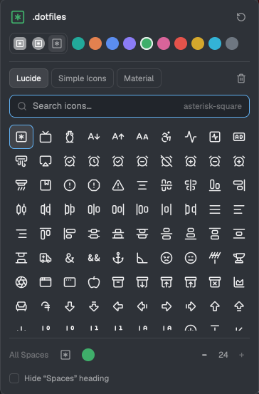

# space-icons

Icons for Herdr spaces, in place of the letter on each space's tile. Three libraries: Lucide,
Simple Icons (brand logos) and Material Symbols.



## Install

Give your agent this:

```
Read ~/.config/herdr-app/AGENTS.md, then add this layout:
https://github.com/scarrillo/herdr-mods/tree/main/space-icons
```

Or by hand, from a clone of this repo:

```sh
cp -R space-icons/mods/space-icon space-icons/mods/spaces-icons ~/.config/herdr-app/mods/
cp space-icons/layouts/main-icons.json ~/.config/herdr-app/layouts/
```

Either way, switch to the layout (no restart; needs Herdr 0.1.16 or later):

```sh
herdr-app do layout.switch '{"name":"main-icons"}'
```

Then click a space's tile, pick a library and press **Download**. Each library is downloaded
once from registry.npmjs.org into the mod's folder and checked against a pinned checksum, using
`curl`, `shasum` and `tar`.

| Library | Icons | Download |
|---|---|---|
| Lucide 1.76.0 | 2,404 | 8 MB |
| Simple Icons 16.38.0 | 3,472 brand logos | 7 MB |
| Material Symbols 0.49.0 (rounded) | 7,890, half of them filled | 2 MB |

## Update and remove

- Update: install it again over the old copy. Keep the `lucide/`, `simple/` and `material/`
  folders inside `mods/space-icon/`, or download the icons again.
- Remove: switch back with `herdr-app do layout.switch '{"name":"main"}'`, then delete
  `mods/space-icon/`, `mods/spaces-icons/` and `layouts/main-icons.json` from
  `~/.config/herdr-app/`. The downloaded icons go with `mods/space-icon/`.

## Use

- Click a space's colored tile to open the picker.
- Lucide, Simple Icons and Material switch the library. In Material, "Filled" switches between
  filled and outlined icons. The trash button, then "Confirm", deletes
  the shown library's icons; spaces using them show an empty tile until it is downloaded again.
- Type to search by name or tag. Arrows move, Enter picks. The picker stays
  open, so you can try several; Esc or a click outside closes it.
- The reset button (a counter-clockwise arrow) at the top puts the space back to Herdr's look: its letter, a square, a palette color.
- The three grey tiles set the space's shape: square, circle or no background. The swatches set
  its color. Both work for spaces showing a letter too.
- The bottom row is for all spaces: its two buttons give this space's shape, or color, to every
  open space and to new ones; `−` and `+` set the tile size (14 to 24).
- The checkbox hides the "Spaces" heading in the sidebar.
- To open it from a key, bind one to `mod.open:space-icon` in `keys.json`. It picks for the shown
  space.

## Good to know

- Icons show in the `main-icons` layout only.
- Icon, color and shape follow a space's name: close a space and open one with the same name,
  and they are back.
- Worktree spaces nested under their repo have no tile.
- `main-icons` and its sidebar are modified copies of Herdr's `main` layout and `spaces` mod at
  0.1.16. Herdr updates don't reach them.

The sidebar and layout come from [Herdr](https://github.com/herdrdev/herdr-app), under Apache 2.0
(`mods/spaces-icons/LICENSE-Herdr.txt`); the changes are marked `space-icons` in the mod, and the
layout's one change is the sidebar mod's name.

Lucide is ISC-licensed (`mods/space-icon/LICENSE-Lucide.txt`), Material Symbols Apache 2.0.
Simple Icons is CC0, but each logo belongs to its brand and may have its own terms.
