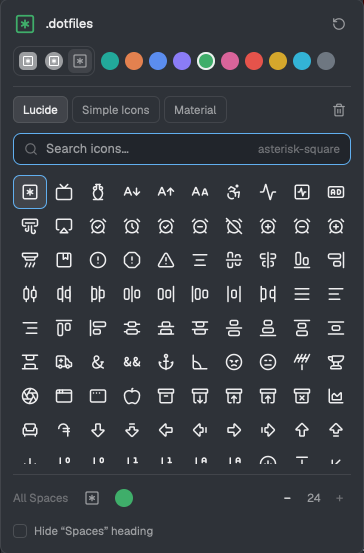

# Space icons

Each space in the sidebar gets an icon in place of its letter. Click a space's tile and a picker
opens: search Lucide, Simple Icons or Material Symbols, set the tile's color and shape, and set
one tile size for every space. Spaces without an icon keep their letter and take the same color, shape and size.

## What you see

**The sidebar** is Herdr's own, with one change per row: the tile left of the space's name.

- Square (rounded), circle, or no background. On a square or circle the glyph is `#ffffff` on
  the space's color; with no background the glyph itself takes the space's color.
- 18 px by default; 14 to 24 px.
- In the narrow rail, a space with an icon shows it in place of its number.

**The picker** is a 364 × 566 px popup. Top to bottom: the tile and the space's name, with
a reset button (Lucide's `rotate-ccw`) when the space has an icon, a shape other than square or a color outside the palette; one row for this space: the three shapes in `muted` inside one `border` frame, then
ten color swatches; a 1 px `border` line; the libraries `Lucide`, `Simple Icons` and `Material`,
the shown one on `selected` and the others in a 1 px `border` outline, with a trash button (remove) at the right once it is downloaded; the search field;
a grid of 10 columns showing 8½ rows, the half row saying there is more; a 1 px `border` line; `All Spaces`,
a button showing the tile's shape in `muted`, a button showing the color, and at the right `−`,
the size, `+`; a checkbox, `Hide “Spaces” heading`.

The swatches are Herdr's six space colors, then `#e5534b`, `#d4a72c`, `#33b3d6`, `#6e7781`.

Before a library is downloaded, the grid's place holds `Download <its title>`, one sentence
saying the download is secure, one-time and verified, and a `Download` button on `accent`.

## How it behaves

- Click a space's tile: the picker opens for that space, its top left 10 px right of the tile
  and 6 px above it. The click doesn't select the space.
- A library's name shows that library; the picker opens on the one shown last.
- In `Material` a `Filled` button follows the libraries: on (the start), the grid holds the 3,945
  `-fill` icons; off, the 3,945 outlined ones.
- Icons are listed by name, those starting with a digit last.
- The trash button turns into `Confirm` in `#e5534b`; the second click deletes the
  library's folder. Spaces keep their choice and show an empty tile until it is back.
- `Download` fetches the shown library, shows `Downloading…`, `Checking the download…` and
  `Unpacking…` in turn, then the grid. A failure shows why in `#e5534b` and leaves the button.
  Color, shape, size and the checkbox work before the download.
- `mod.open {"name":"space-icon"}` opens it for the shown space.
- Typing filters: names starting with the text, then names containing it, then tags. An empty
  search lists the 20 icons picked last, then every icon by name.
- Arrow keys move through the grid; Enter or a click picks. The picker stays open; Esc or a
  click outside closes it.
- The reset button gives this space Herdr's look, whatever `All Spaces` set: its letter, a
  square, and the palette color the fewest other spaces have.
- Everything applies at once and leaves the picker open.
- The swatches and shapes above the first line are this space's. The row under the second line
  is for every space: size, in steps of 2, and two buttons.
- The shape button gives this space's shape to every open space and to spaces made later; the
  color button does the same with its color.
- The name at the right of the search field, in `dim`, is the icon under the keyboard, or the
  one clicked last.
- The checkbox removes the word `Spaces` above the list; the `+` beside it stays at the right.
- Close a space and open one of the same name on the same machine: its icon, color and shape
  are back.

## Built from

- `layouts/main-icons.json`: Herdr's `main` (0.1.16) cloned with `layout.clone`; the `spaces`
  block's `content.mod` is `spaces-icons`.
- `mods/spaces-icons/`: Herdr's `spaces` (0.1.16) cloned with `mod.clone`. Every change is
  marked `space-icons`.
- `mods/space-icon/`: the picker, with `search.svg`, `check.svg`, `rotate-ccw.svg` and `trash.svg` (Lucide's) for its own
  controls. It reads `<library>/index.json`, `[[name, "words to search"], …]`, with
  `readTextFile`; `<library>/<name>.svg` are the icons. Neither is in the repo.
- The libraries, each one npm package at a pinned version and sha512 (`LIBRARIES` in `main.js`):
  - `lucide`: `lucide-static` 1.76.0, `package/icons`, words from `package/tags.json`; 2,404.
  - `simple`: `simple-icons` 16.38.0, `package/icons`, words from the titles and aliases in
    `package/data/simple-icons.json`; 3,472.
  - `material`: `@material-symbols/svg-400` 0.49.0, `package/rounded`, words from the file
    names; 7,890 (`<name>` and `<name>-fill`).
- The download, all in `main.js` through `exec`: `curl` fetches the package's tarball from
  registry.npmjs.org into a hidden `.fetch-<library>/` folder in the mod; `shasum -a 512` must
  match the pinned sum; `tar` unpacks the icon folder and the words file; `index.json` is
  written with `writeTextFile`; one `sh -c` swaps the folder in as `<library>/` and removes the
  hidden one. The trash button runs `rm -rf` on `<library>/`.
- Network: registry.npmjs.org, on the button only. Programs: `rm`, `mkdir`, `curl`, `shasum`,
  `tar`, `ls`, `sh`. The sidebar mod runs nothing.
- Shared state:
  - `space.icons`: `{ ids: { <space id>: <icon> }, names: { "<machine>/<name>": <icon> } }`;
    `<icon>` is a Lucide name (`heart`) or `<library>/<name>` (`simple/github`)
  - `space.icons.library`: the library the picker showed last
  - `space.icons.filled`: `false` when Material shows its outlined icons
  - `space.icons.recent`: icon names, newest first, at most 20
  - `space.icons.style`: `{ ids: { <id>: { shape } }, names: { "<machine>/<name>": { shape, color } }, size, default: { shape, color }, hide_label }`
  - `space.colors` (Herdr's): `{ <space id>: "ansi1".."ansi6" | "#rrggbb" }`
  - Lookups go by id, then by name, then `default`. Ids of closed spaces are dropped on each
    write; names are kept.

## Watch out

- Herdr can't change how its own sidebar draws a space: the sidebar and the layout must be
  clones, and Herdr never updates clones. For a newer sidebar, clone again and re-apply the
  marked lines.
- Saving a file in a mod's folder reloads the mod and stops its tasks: build the download in a
  hidden folder (Herdr ignores those) and swap it in with one command.
- Lucide's `tags.json` names 2,092 icons; 2,404 SVGs ship. List the unpacked files for names.
- One download at a time: the reload a finished one causes would stop another halfway.
- The icon index can't be a static `import`: a missing file would keep the picker from loading.
- The download needs `curl`, `shasum` and `tar` (stock on macOS).
- Deleting goes through one function that builds the library's folder from Herdr's home and a
  fixed name, and refuses a home that isn't a plain absolute path.
- Icons show only in the `main-icons` layout.
- The grid draws only the rows in view. A virtual list's renderer refuses `on_click`, so the
  grid windows itself.
- The tile must stop its left mouse-down, or the row's mouse-up selects the space.
- A mod can't import another mod's files: `tile` exists in both mods and must stay the same.
- Herdr drops a closed space's color from `space.colors`; the copy under `names` restores it.
- Worktree spaces nested under their repo have no tile.
- Opening the picker takes the keyboard.
- The `All Spaces` color button overwrites every space's color; there is no undo.

## Done when

- `herdr-app check` passes for both mods, and `herdr-app status` lists no errors with the
  `main-icons` layout shown.
- Clicking a tile opens the picker for that space and doesn't switch spaces.
- With no `lucide/index.json`, the picker opens and shows `Download`; pressing it ends
  with the grid. The same for `simple` and `material`.
- An icon from each library shows on its space's tile in the sidebar.
- The trash button, then `Confirm`, brings that library's `Download` back.
- Typing `heart` puts `heart` first; Enter sets it and the tile shows it.
- A swatch, a shape and `+`/`−` each redraw the tile at once.
- The `All Spaces` buttons change every row, and a space made afterwards takes that color and
  shape.
- A space closed and opened again under the same name shows its icon, color and shape.
- A space with no icon still shows its letter.
